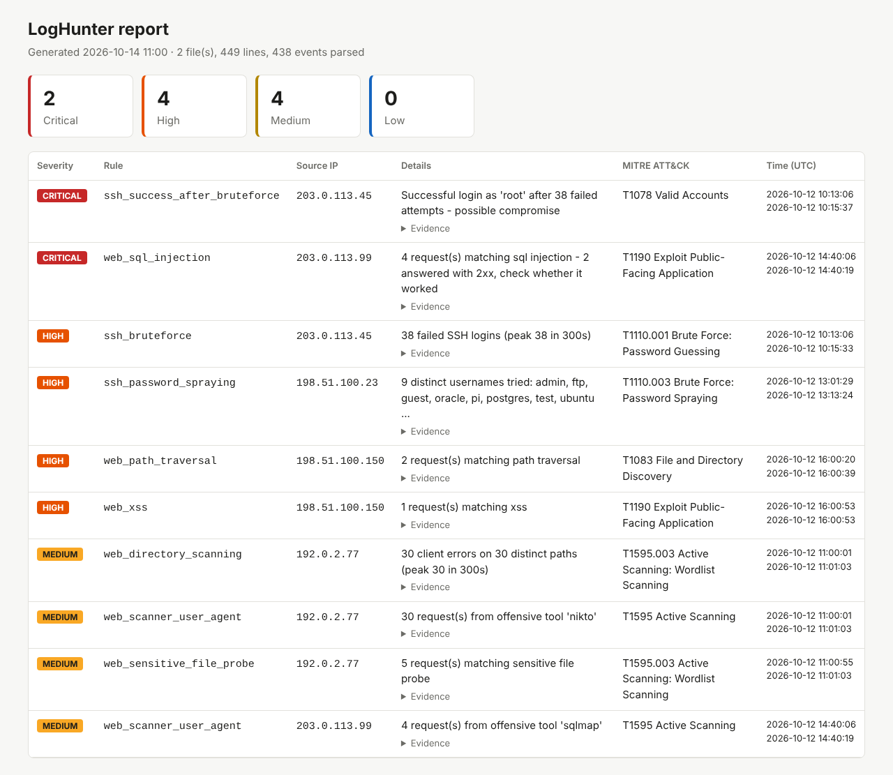

# LogHunter

[](https://github.com/AlawiAhmedDev/loghunter/actions/workflows/ci.yml)


**A lightweight blue-team tool that hunts for attacks in SSH and web server logs and maps every alert to MITRE ATT&CK.**

*[Version française](README.fr.md)*

LogHunter reads OpenSSH `auth.log` and Apache/Nginx access logs, normalises them into events, runs detection rules over sliding time windows, and produces a triage-ready report in the terminal, as JSON (for a SIEM or a script), or as a standalone HTML page.



## What it detects

| Rule | What it means | Severity | MITRE ATT&CK |
|---|---|---|---|
| `ssh_success_after_bruteforce` | Successful login from an IP that failed many times before. The password may have been guessed | Critical | T1078 |
| `ssh_bruteforce` | Too many failed logins from one IP inside a sliding window | High / Critical | T1110.001 |
| `ssh_password_spraying` | One IP tries many different usernames | High | T1110.003 |
| `web_sql_injection` | `UNION SELECT`, `' OR '1'='1`, `SLEEP()`, etc. Escalated to critical when the server answered 2xx | High / Critical | T1190 |
| `web_xss` | `<script>`, `onerror=`, `javascript:` in the URL | High | T1190 |
| `web_path_traversal` | `../`, `/etc/passwd`, also double URL-encoded | High / Critical | T1083 |
| `web_command_injection` | `; cat`, `| id`, `$(...)`, backticks | High / Critical | T1059 |
| `web_sensitive_file_probe` | Requests for `.env`, `.git/`, `wp-config.php`, backups | Medium | T1595.003 |
| `web_directory_scanning` | Burst of 4xx responses on many paths from one IP | Medium | T1595.003 |
| `web_scanner_user_agent` | Known offensive tools: sqlmap, Nikto, Nmap, gobuster, Nuclei... | Medium | T1595 |

## Quick start

```bash
git clone https://github.com/AlawiAhmedDev/loghunter.git
cd loghunter
pip install -e .            # no third-party dependencies

loghunter analyze samples/auth.log samples/access.log --year 2026
```

Example output:

```text
LogHunter - security log analysis
Files: 2   Lines: 449   Parsed events: 438   Skipped: 11
Summary: critical=2  high=4  medium=4  low=0

[CRITICAL] ssh_success_after_bruteforce  ip=203.0.113.45
           Successful login as 'root' after 38 failed attempts - possible compromise
           MITRE: T1078 Valid Accounts
           2026-10-12 10:13:06 -> 2026-10-12 10:15:37

[CRITICAL] web_sql_injection  ip=203.0.113.99
           4 request(s) matching sql injection - 2 answered with 2xx, check whether it worked
           MITRE: T1190 Exploit Public-Facing Application
...
```

### On a real server

```bash
sudo loghunter analyze /var/log/auth.log /var/log/nginx/access.log
sudo loghunter analyze /var/log/auth.log.*.gz          # rotated logs work too
loghunter analyze access.log -f html -o report.html    # HTML report
loghunter analyze access.log -f json -o alerts.json    # for a SIEM or jq
```

### Options

| Option | Default | Description |
|---|---|---|
| `-f, --format` | `text` | `text`, `json` or `html` |
| `-o, --output` | stdout | Write the report to a file |
| `--threshold` | `5` | Failed SSH logins in the window that raise brute force |
| `--window` | `300` | Sliding window, in seconds |
| `--spray-users` | `5` | Distinct usernames that raise password spraying |
| `--scan-threshold` | `20` | 4xx responses in the window that raise scanning |
| `--min-severity` | `low` | Hide alerts below this level |
| `--fail-on` | off | Exit with code 2 if an alert at this level or above exists |
| `--year` | current | Year for syslog lines, which carry none |

`--fail-on` makes LogHunter usable in a cron job or a CI pipeline:

```bash
# every hour, email the admin if something high or critical shows up
0 * * * * loghunter analyze /var/log/auth.log --fail-on high -o /tmp/lh.txt || mail -s "LogHunter alert" admin@example.com < /tmp/lh.txt
```

## How it works

```
 log files ──► parsers.py ──► Event ──► detectors.py ──► Alert ──► report.py
 (.log/.gz)    format auto-   (normalised,  sliding windows,    severity,     text / JSON
               detected per   UTC time)     regex signatures,   MITRE ID,     / HTML
               line                         correlation         evidence
```

- **Parsing**: each line is matched against the syslog / ISO-8601 sshd formats and the Apache/Nginx combined format. Timestamps with a timezone are normalised to UTC. Month names are parsed without the system locale, so it works on a French or Arabic system too. Unknown and malformed lines are counted and skipped.
- **Sliding windows**: brute force and scanning use a two-pointer sliding window, so 5 failures in 2 minutes alert but 5 failures across a day do not.
- **De-duplication**: sshd logs both `Invalid user X` and `Failed password for invalid user X` for a single attempt; LogHunter counts it once.
- **Decoding**: URLs are decoded twice to catch double-encoding evasion such as `%252e%252e%252f` → `../`.
- **Correlation**: a 2xx response to an injection payload, or a successful login after a brute force, raises the severity, because the attack may have worked.

## Project layout

```
loghunter/
├── loghunter/
│   ├── parsers.py     # SSH + web log parsing, format auto-detection
│   ├── detectors.py   # detection rules and MITRE mapping
│   ├── report.py      # text, JSON and HTML output
│   ├── models.py      # Event and Alert dataclasses
│   └── cli.py         # command-line interface
├── samples/
│   ├── generate.py    # builds realistic logs with known attacks
│   ├── auth.log
│   └── access.log
├── tests/             # 27 pytest tests, including an end-to-end run
└── docs/              # sample reports and screenshot
```

## Tests

```bash
pip install -e ".[dev]"
pytest -v
```

The tests check every parser and rule, the false-positive cases (a user who mistypes a password once, benign URLs containing words like *select* or *union*), and an end-to-end run on the bundled samples. They run on Python 3.10–3.13 in GitHub Actions.

## Sample data

`samples/generate.py` builds the sample logs from a fixed seed. They contain normal traffic plus five scenarios: a brute force that ends in a successful root login, slow password spraying, a Nikto scan, a sqlmap SQL injection, and manual path-traversal and XSS attempts. All IPs come from the RFC 5737 documentation ranges.

## Roadmap

- [ ] GeoIP and AbuseIPDB enrichment of source IPs
- [ ] Rules in YAML files (Sigma-style) instead of Python
- [ ] Watch mode (`tail -f`) for real-time alerting
- [ ] Windows Event Log (4625 / 4624) support
- [ ] Export to Elasticsearch / Wazuh

## Disclaimer

LogHunter is a learning and triage tool. Signature-based rules miss obfuscated attacks and can raise false positives. It does not replace a SIEM or an IDS. Only analyse logs you are authorised to access.

## Author

**Alawi Ahmed**, MSc in Cybersecurity and Artificial Intelligence
GitHub: [@AlawiAhmedDev](https://github.com/AlawiAhmedDev)

## License

[MIT](LICENSE)
